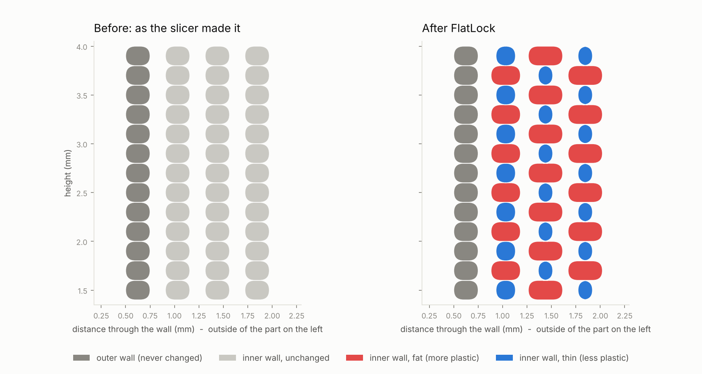
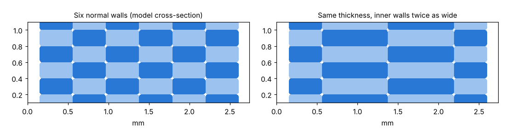
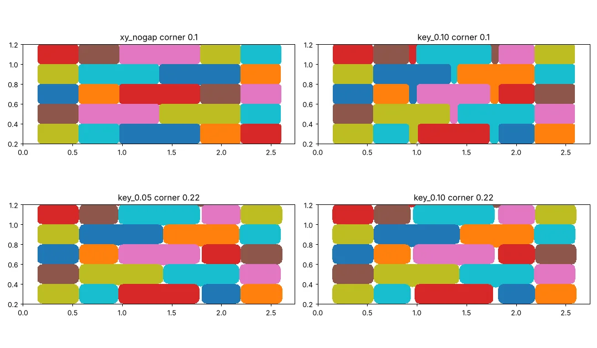
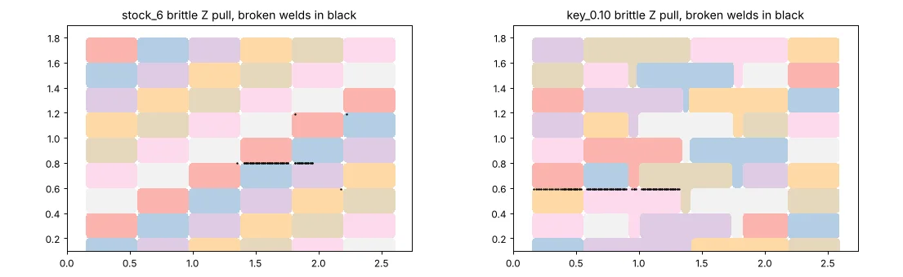
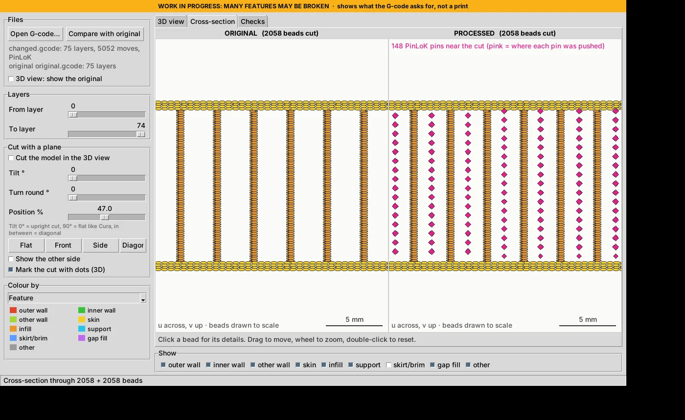
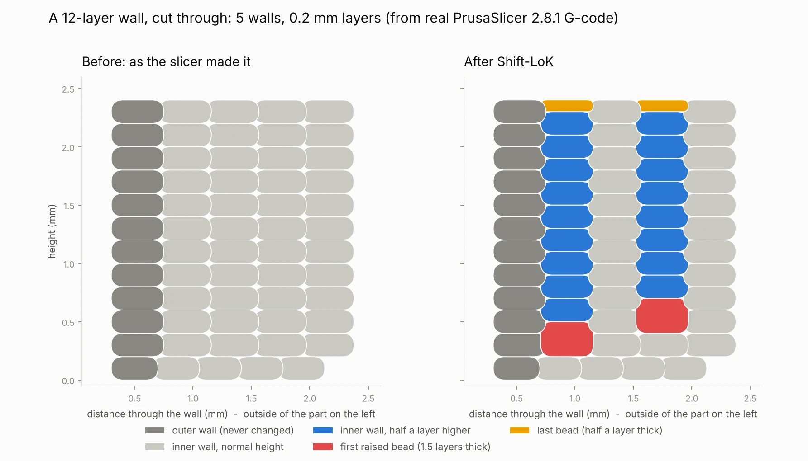

# A Bonding Experience

## The open-source new frontier of Z-delamination resistance

**A hobbyist's field guide to Z-strength in FDM printing without tripping over patents, including a defensive publication of PinLoK (pinned infill) and the many ideas that didn't work.**

Matthew Armstrong · GitHub [The-Dorkknight](https://github.com/The-Dorkknight) · United Kingdom\
First published 13 October 2026 · Version 1.0\
Text and figures: [CC BY-SA 4.0](LICENSE.md). Code that comes with it: [PolyForm Noncommercial 1.0.0](LICENSE-CODE.md).

> **Status, honestly: every strength number for my own ideas in this paper (including Shift-LoK, FlatLock and PinLoK) is theoretical.** They come from a computer simulation, not from printed and tested parts. They are not measurements, not product claims, and not claims about anyone else's product or patent. The model has known blind spots (section 3). Numbers from other people's real tests are marked as such and linked to their sources. If you print the test bars before I do, please tell me who won.

> **Not legal advice.** I am not a lawyer. Where patents come up I say what I found and where I found it, and that a patent attorney is the person to ask.

---

## Abstract

FDM prints are weakest between layers. The best-known trick for that, staggering alternate walls by half a layer ("brick layers"), is the subject of granted US patents, whose validity and reach are disputed. I wanted stronger Z without stepping on them, and to keep whatever I found free for hobbyists.

This paper is the lab notebook of that hunt:

- **The ideas:** twelve of them, from "loopholes" in the patent wording to over-extruded "squish" beads, keyed gaps, wide inner walls, thin layers and non-planar printing.
- **How they were judged:** most were run through a 2-D bead-by-bead strength model; the rest were checked by arithmetic or against published real-world tests.
- **The winner:** pinned infill, which I call **PinLoK**. It builds on Oak Ridge National Laboratory's published Z-pinning. Every few layers the nozzle stops over the open gaps in Grid infill and pushes a blob of plastic down into each one. Two interleaved sets take turns, so the joints never line up.
- **How much it might help:** in the simulation (theoretical, not tested), pinned Grid infill was 16 to 27 % stronger across the layers than plain solid infill of the same weight. That's after a late discovery: pin tops should end half-way through a layer, not on a layer line. A "potato" mode keeps each push to about a second, for stock printers.
- **The other partial success** needs no software at all: inner walls about 1.5 times the nozzle width.
- **Everything else** either didn't help in the model or can't be done without beads of different heights. That is exactly where the patents live.

Section 9 discloses PinLoK and its variations in enough detail to build them. It is written to be prior art, so the method stays free for everyone to use.

---

## 0. Why this paper exists (the bit with the jokes)

Here's the situation:

1. Printed parts snap along their layer lines like a KitKat.
2. A nice fix exists: stagger alternate walls half a layer.
3. Somebody has patented it.
4. I'm a hobbyist in the UK with a 3D printer, a laptop, and a pathological inability to leave an efficiency problem alone.

Dangling a design challenge in front of an engineer is like dangling catnip in front of a cat. You can predict the outcome; you just can't predict how many hours it eats.

So I went looking for every way to get stronger layers that *doesn't* need the patented geometry. On the way I built a small app called **LoK Walls**, with three patterns:

- **FlatLock:** fat and thin walls.
- **Shift-LoK:** my own brick-layer implementation, shipped locked.
- **PinLoK:** pinned infill.

I also ran a lot of ideas through a strength model that told me, politely and repeatedly, that they didn't work.

**About ADDMAN.** ADDMAN (Addman Intermediate Holdings, LLC) holds the brick-layer patents. I haven't contacted them yet. I do intend to ask whether the hobby community can use their technique for free, non-commercial printing, and a draft letter is sitting in my repository. In the meantime I found waiting for humans to achieve my design intent too inefficient, so I went round the problem instead of through it. Shift-LoK stays locked and unpublished until they answer.

**Why publish all of this, including the failures?** Four reasons:

1. **Protection.** Once a method is published, nobody can validly patent it afterwards: it's no longer new. Publishing PinLoK, and every variation I could think of, in detail and with a date on it is the cheapest way I know to keep it free for hobbyists. That's what a *defensive publication* is.
2. **Saving you time.** Every dead end in here is one you don't have to walk down. Several of them looked brilliant at 2 a.m.
3. **Bringing people together.** Open notebooks like this are how makers and tinkerers build on each other's work instead of repeating it (section 11).
4. **Selfishly:** sharing techniques means I get more cool 3D-printing programs and techniques back from the community. Also, by my calculations, publishing a research paper makes me 22.713333…% more employable (the 3 recurs; I checked). That is a very high-efficiency synergistic effect, and I'd like it on record.

**How this was made.** The ideas, the questions and the stubbornness are mine. The modelling code, the G-code tools and much of the literature search were done with an AI assistant (Claude, by Anthropic), working to my design intent. It was considerably faster than waiting for humans, see above. All sources are linked so you can check them, and the code is included so you can re-run every number.

---

## 1. The problem: why layers let go

An FDM print is a stack of thin layers. Each bead is a squashed, rounded noodle of plastic welded to the one below while it's still warm. Within a bead the plastic is solid. Between beads it's only as strong as the weld, and the welds between layers are the weakest of all.

In a normal wall every layer ends at the same height, so all the weak welds line up in one flat plane. Pull the part along Z and it unzips along that plane.

How weak is "weak"? Some real measurements by Stefan Hermann of CNC Kitchen (not mine):

- **Standing samples, PLA:** layer strength was about 37–40 MPa against roughly 60 MPa for the same plastic printed lying down ([temperature test](https://www.cnckitchen.com/blog/the-influence-of-extrusion-temperature-on-layer-adhesion)).
- **Standing samples, PETG:** at a cool 200 °C, only 18 MPa.
- **Standing hooks:** in his layer-height test they held "at least 50 % less" than lying ones ([layer-height test](https://www.cnckitchen.com/blog/the-influence-of-layer-height-on-the-strength-of-fdm-3d-prints)).

So there's a lot of strength sitting on the table.

The target I set myself: **at least 7 % more strength across the layers**, with **no beads of different heights** (that's the patented bit, section 2), **printable on a stock 0.4 mm-nozzle printer**, and **free for hobbyists**.

---

## 2. The patent landscape (as I found it on 6–13 October 2026)

Short version: the half-layer stagger is patented in the United States. Europe has an application pending, not granted. I found nothing granted in the UK.

| Document | Where | Status found | What it's about |
|---|---|---|---|
| [US 11,331,848 B2](https://patents.google.com/patent/US11331848B2/en) | US | Granted 2022, active | End beads laid crosswise at half width, alternating between layers |
| [US 11,813,789 B2](https://patents.google.com/patent/US11813789B2/en) | US | Granted 2023, active | **Bead height.** Claim 3: bottom and top layers "in alternating bead height layers of a first height and a second height" |
| [US 12,017,407 B2](https://patents.google.com/patent/US12017407B2/en) | US | Granted 2024, active | Walls of alternating width with infill in the gaps |
| [EP 4 094 924 A1](https://patents.google.com/patent/EP4094924A1/en) (EP 21175830.5) | Europe | Pending; six third-party observations filed against it | Broad: beads overlapping "in a potential shear plane" |

All of these trace back to inventor Mark Saberton and are assigned to Addman Intermediate Holdings, LLC.

**Prior art people point to:**

- **[PrusaSlicer issue #1823](https://github.com/prusa3d/PrusaSlicer/issues/1823)** (February 2019), "alternating perimeter layers (hexagonal walls)": shifting alternate perimeters by half a layer, before the first ADDMAN filing in November 2019.
- **[US 5,653,925](https://patents.google.com/patent/US5653925A/en)** (Stratasys, filed 1995, expired 2015): a hexagonal bead packing offset sideways. That is related but not the same thing.
- **Existing tools:** free scripts by [Tenger Technologies](https://github.com/TengerTechnologies/Bricklayers) and [GeekDetour](https://github.com/GeekDetour/BrickLayers), and an [OrcaSlicer pull request](https://github.com/OrcaSlicer/OrcaSlicer/pull/8181).

Whether any of that affects the patents is a question for lawyers, not me.

Claim 3 of US 11,813,789, as Google Patents shows it, ends: the bottommost and uppermost layers "are each deposited along the X-axis or Y-axis in alternating bead height layers of a first height and a second height", with the beads of each intermediate layer "of uniform height". Read the full claims yourself; this is a quote, not an interpretation.

**Why the patents matter for design-arounds.** To stagger walls by half a layer, the raised wall has to start half a layer up and finish half a layer up. At the bottom and top of the part, *something* has to be a different height from its neighbours: a 1.5-layer first bead, a 0.5-layer last bead, or an empty gap. That follows from geometry, not from anyone's wording, and it brings every stagger I could think of close to the wording of claim 3 (section 4). Whether something actually falls inside a claim is for a patent attorney. My rule for this project was simpler: **no beads of different heights, anywhere.**

---

## 3. How the ideas were judged: a strength model with honest limits

I don't have a tensile tester (yet). So each idea went through a small **2-D cross-section model**:

1. **Laying beads.** A slice through the wall is built bead by bead on a 0.005 mm pixel grid, in printing order. Each bead has a fixed amount of plastic, is flattened on top by the nozzle, and spreads sideways into whatever room is left. It can't fill corners sharper than a set radius, which stands in for surface tension. Voids and weld lines come out of that by themselves.
2. **Springs.** A triangular net of springs is laid over the picture. Springs inside a bead are full strength; springs crossing between beads are welds at half strength. There are no springs in voids.
3. **Pulling.** The net is loaded three ways:
   - across the layers (**Z**, the one this paper cares about);
   - sliding the layers over each other (**shear**);
   - pulling walls apart sideways.

   Each load is solved two ways: a "tough" limit where every weld holds until they all give together, and a "brittle" pull where welds snap one by one, so a crack can run along a layer line.

Each idea was usually run with two settings for how well plastic fills corners: a larger minimum corner radius (22 % of the layer height: rounder, less-filled corners) and a smaller one (10 %: sharper, better-filled corners). Where a range is given it is the spread between those runs, unless it says otherwise. The Shift-LoK and FlatLock ranges span every assumption tried in the original study (weld strength, corner filling, layer height, wall height); the PinLoK range spans its modes and the two ways of breaking.

**What the model gets wrong** (please read this before quoting any number):

- **No squeeze pressure.** Real beads pressed into tight spaces bond better; the model only knows shapes.
- **Fixed weld strength.** Real welds depend on temperature, speed, material and cooling time.
- **No cooling.** Any idea that makes the printer pause gets no penalty here, which is relevant to pins.
- **2-D.** No corners, seams, skins or real part shapes.
- **Perfect printing.** No ooze, no strings, no slop.
- **More pessimistic than real tests for brick layers.** CNC Kitchen measured +14 % (PLA) and +10 % (PETG) for brick layers at 0.25 mm layers (944 N against 1072 N in PLA, test parts without infill). The model gives about +1 %.

All the model code and every result file are in [`model/`](model/), so you can re-run, argue with or improve every number here.


---

## 4. The "loopholes" (spoiler: geometry doesn't care about wording)

### 4.1 Variable first layer plus over-extrusion

**The idea:** give alternate walls a different first-layer height, so they're naturally offset, then over-extrude the gap away. Surely a loophole?

**What happens:** a wall that starts half a layer higher leaves a half-layer hole underneath it. Fill it with one over-extruded bead and that bead is 1.5 layers tall next to normal-height neighbours. That's alternating bead heights in the bottom layer: the same geometry as before, reached by a different road.

The other readings don't help either:

- If "alternating by one layer" means a whole-layer offset, the layer lines of neighbouring walls line up again, so there's no stagger.
- A global variable first-layer height moves *every* wall, so there's no stagger either.

**Verdict:** not a loophole I'd rely on, because it reproduces the same geometry. US and UK law also have "equivalents" doctrines that can reach near-copies; only a patent attorney can say how they'd apply. Not built.

### 4.2 Smaller or multi-phase staggers

**The idea:** maybe a quarter or third of a layer, or three- or four-phase patterns, give the benefit with "less" patent.

| Pattern | Z (rounder / sharper corners) | Shear |
|---|---|---|
| Half-layer (Shift-LoK) | 0 / +9 % | +32 / +34 % |
| Quarter-layer | −1 / −5 % | +31 / +27 % |
| Third-layer | 0 / +1 % | +40 / +36 % |
| Three-phase (0, ⅓, ⅔) | +1 / +4 % | +47 / +46 % |
| Four-phase (0, ¼, ½, ¾) | +3 / +1 % | +50 / +51 % |

**What happens:** every stagger is great at resisting *sliding* (+27 to +51 %) and does nearly nothing for pulling layers *apart*. More importantly, any stagger at all needs different bead heights at the top and bottom, so smaller steps don't escape the geometry from section 4.1.

**Verdict:** still close to the same wording, and little Z gain in the model.

### 4.3 Different layer heights per wall

**The idea:** some walls at 0.2 mm, others at 0.3 or 0.4 mm, so the layer lines don't line up. "Non-planar has been around for ages; surely the patents on variable layer height have expired?"

**Model:** −1 to −11 % in Z. Fat layers bond worse, and the weakest seam still decides.

**Patents:** some variable-layer-height art is indeed old and expired: Stratasys US 5,653,925 (expired 2015), and adaptive slicing from 1990s academic papers (Dolenc & Mäkelä, 1994; Sabourin et al., [1996](https://www.emeraldinsight.com/insight/content/doi/10.1108/13552549610153370/full/html)). But *not all of it* has expired:

- I found **US 11,865,787 B2** (variable-thickness, non-parallel layers, robotic deposition, 2018 priority) and Autodesk's **US 10,005,126 B2** listed as active. I didn't check their claims or expiry dates.
- An expired *general* patent doesn't free a *specific* later one anyway. The ADDMAN claims are about the bead heights themselves.

**Verdict:** weaker in the model, and no clean escape.

### 4.4 Non-planar (wavy) layers

Wavy layers where neighbouring layers nest into each other exist as open-source tools (for example TenTech's sine-wave script, 2025), but I found no strength data for them. My 2-D model can't represent a 3-D wave, so this is **untested here** and on the to-do list.

---

## 5. Ideas that keep every bead the same height

### 5.1 FlatLock: fat and thin walls

**The idea:** alternate inner walls get 125 % and 75 % of their plastic, swapping every layer, so a fat bead always sits on a thin one and the seams wiggle sideways. Nothing moves up or down.



**Model:**

| Load | Base case | Range over assumptions |
|---|---|---|
| Z | −8 % | −17 to −4 % |
| Shear | −3 % | — |
| Sideways | 0 % | — |

Every layer still ends at the same height, so the weak plane is still flat. Thin beads just make it thinner.

**Also:** a published Chinese application, **CN 122442952 A** (alternating line width per layer, one applicant example claiming +6.25 % Z tension), looks similar. It's an application, not a grant.

**Verdict:** built, shipped as an experiment, and honestly labelled "no gain shown".

### 5.2 Squish-LoK: an over-extruded squish bead

**The idea:** lay the normal beads first, then lay a "squish" bead last in the layer with 15–30 % extra plastic at the same height. It should push into the notches beside the rounded beads and seal them.

**Variants tried:** the middle wall; alternate walls; every 2nd or 3rd layer; staggered per wall; outer walls only.

**Model:** −8 to +1 % in Z.

**Why it fails:**

- In a normal wall the gaps between round beads are only **1–3 % of the cross-section**, so there's very little to fill.
- 5–13 % of the extra plastic found nowhere to go. On a real printer it would bulge the surface or build nozzle pressure.
- Molten plastic won't go into corners sharper than surface tension allows, however hard you push.

**Verdict:** dead. Pleasingly squishy name, though.

### 5.3 Wide inner walls (the partial success that needs no software)

**The idea:** keep the outer wall about nozzle-width for looks, and make the inner walls much wider and flat. That means fewer vertical seams and flatter beads.



**Model, Z strength at the same total wall thickness:**

| Inner wall width | Z |
|---|---|
| 1.33x (about 0.6 mm) | +2 to +4 % |
| 2x | +4 to +9 % |
| 4x | +5 to +13 % |

**Real-world check:** CNC Kitchen's [extrusion-width test](https://www.cnckitchen.com/blog/the-effect-of-extrusion-width-on-strength-and-quality-of-3d-prints) (0.4 mm nozzle, PLA) found layer adhesion *rose with width up to about 150 % (0.6 mm) and then fell*, with surface defects from about 160 %. Two perimeters at 200 % made the strongest hooks.

**The catch:** the model can't see the nozzle. A bead much wider than the nozzle's flat tip isn't pressed down at its edges, so the 2x and 4x results are optimistic. Some reference points:

- Bambu's wiki recommends 0.75–1.5x the nozzle diameter.
- A Bambu forum user *estimates* the flat of a Bambu 0.4 nozzle at about 0.8 mm. That's not measured, and clones vary.
- Flow is the other limit: a 0.8 mm line at 0.2 mm layers and 200 mm/s wants 32 mm³/s, which most stock hot ends can't melt.

**Verdict:** the best *walls* idea, and it's a setting every slicer already has. Try outer wall 0.42 mm, inner walls 0.6 mm, against all walls at 0.42 mm with the same total thickness. There are no height differences and nothing is staggered, so the bead-height claims don't obviously apply (my reading, not legal advice). (I deliberately *also* tried a sideways "brick bond" with mixed widths. That came in at +3 to +6 %, worse than plain wide walls because it adds seams, and it's closer to US 11,331,848's territory.)

### 5.4 Squish-KeyLoK: keyed gaps

**The idea:** mixed-width walls whose seams move sideways every layer (1-2-2-1, then 1-1-2-1-1), so every inner seam sits under the middle of a bead in the next layer. Leave a deliberate 0.05–0.1 mm gap at each inner seam, and over-extrude the bead above to push a "key" down into it. The layer then can't unzip in one go: it might be locally weaker, but surely it can't delaminate along a whole plane?



**Model:**

- **Keys form:** with 0.1 mm gaps the model makes proper T-shaped keys. With 0.05 mm gaps, or stiffer plastic, the slots partly stay empty.
- **Tough limit:** 0 to +3 % in Z, the same as without gaps.
- **Brittle pull** (the "won't delaminate" test): **−2 to −19 %**.



**Why:** the crack still ran straight along one layer line and snapped each key off at its root. A 0.1 mm key is a thin neck with sharp corners, which concentrates stress instead of spreading it, and the slot steals bonding area from the beads on either side. To really force a crack to change layers you need keys much wider and deeper, which is a half-layer stagger again. Also, 0.05–0.1 mm is about the size of normal bead-width wobble on a real printer.

**Verdict:** dead, but it led straight to the next idea.

### 5.5 Thin, fast layers

**The idea:** 0.1 mm layers make beads flatter and the notches between them smaller.

**What happens:** the notches do shrink. A 0.45 x 0.1 mm bead has the same shape as a 0.9 x 0.2 mm bead. But you get twice as many layer lines, and the weakest one decides. CNC Kitchen's layer-height test found standing hooks at 0.05–0.2 mm all held up well, with 0.15 mm the strongest: "going below 0.15 mm buys you nothing but print time". At 0.3 mm (more than half the nozzle) they held only about half the load.

**Verdict:** keep layers at or below half the nozzle diameter; going thinner isn't worth it.

---

## 6. Things other people found (not tested by me)

| Method | What it does | Published result | Notes |
|---|---|---|---|
| Hotter printing | Better fusing | CNC Kitchen: PETG layer strength 18 → 32 MPa from 200 to 245 °C; PLA peaked at 230 °C | Cheapest lever there is |
| Layers ≤ half the nozzle | — | 0.3 mm on a 0.4 nozzle held about half the load | — |
| Salt remelting | Bury the part in fine salt and re-melt it in an oven | CNC Kitchen: ABS layer strength +150 %; PLA and PETG close to full material strength ([source](https://cnckitchen.com/blog/testing-the-strength-of-3d-prints-re-melted-in-salt)) | Post-process; pores, tight threads; under 1 % size change |
| Annealing | Crystallise PLA | No change in layer strength; up to 10 % warping ([source](https://cnckitchen.com/blog/better-performing-3d-prints-with-annealing-but-part-1-pla)) | Doesn't fuse layers |
| Laser pre-heating | Heat the layer just ahead of the nozzle | About +50 % bond strength (Ravi, Deshpande & Hsu, *J. Manufacturing Processes* 24, 2016) | Hardware; see also US 10,710,353 (holder and status not checked) |
| Infrared pre-heating | Heat the top layer with a lamp | "Significant improvements" (Kishore et al., ORNL, *Additive Manufacturing* 14, 2017) | Big printers |
| Microwave welding | Carbon-nanotube-coated filament, heated at the joins | Reported 275 % stronger (Sweeney, Green et al., Texas A&M, *Science Advances*, 2017) | Special filament; licensed to Essentium |
| Less cooling, enclosure, dry filament | Warmer joins, fewer bubbles | Widely advised; I found no clean numbers | — |

---

## 7. Z-pinning, and why walls were the wrong place for it

Oak Ridge National Laboratory (ORNL) published **Z-pinning**: leave vertical voids in the part, then fill them with material that runs continuously through several layers.

- **The 2018 paper** ([ORNL, Solid Freeform Fabrication Symposium](https://utw10945.utweb.utexas.edu/sites/default/files/2018/198%20ZPinningApproachforReducingMechanicalAnisotr.pdf)) pinned **35 % rectilinear infill** (carbon-fibre PLA). Pins were 8 layers deep, a new set every 4 layers, staggered A/B, with the nozzle held still over each void at 240 °C. Z strength went from 2.8 MPa without pins to 7.2 MPa with pins at 80 % of the void volume; a plain 55 % infill of similar weight reached 5.1 MPa, so the fair comparison is about +40 %. Pin volumes above 100 % spill between layers, which adds interlocking; an earlier study had set 80 % as the practical limit to avoid print problems, but this paper also tested 120 % and 160 %, and strength kept rising.
- **The 2019 journal paper** (Duty et al., [*Additive Manufacturing* 27](https://ornl.gov/publication/z-pinning-approach-3d-printing-mechanically-isotropic-materials)) reported more than 3.5 times the Z strength and toughness in PLA and carbon-fibre PLA, and roughly isotropic parts at the largest pin volume. That multiple is against the same sparse infill without pins, which is weak to begin with.
- **A 2019 follow-up** ([SFF 2019](https://utw10945.utweb.utexas.edu/sites/default/files/2019/147%20Increasing%20the%20Interlayer%20Bond%20of%20Fused%20Filament%20F.pdf)) tried pins in a **solid wall**. A normal wall was 33 MPa; the pinned wall was 16–17 MPa. The 55-second pause for each set of pins let the layers cool, which cost more than the pins gave back. Cracks followed under-filled pins.

**My first instinct** was a 0.5 × 0.5 mm channel, 4 mm deep, in the walls: rebar gripping the channel sides. The arithmetic killed it:

- **Strength:** a pin adds at most its own cross-section of solid plastic across a layer line. Solid PLA is about 60 MPa against about 40 MPa for a layer bond, so the gain is roughly *half the share of the wall that is pin*. +7 % needs about 14 % of the wall to be pin: in a 2 mm wall, one pin every 0.9 mm.
- **Grip isn't the problem:** a thin pin's side bond is stronger than the pin itself, so it snaps before it pulls out.
- **Filling:** the nozzle tip is wider than 0.5 mm, so it can't get in, only sit on top and push. Too narrow and it blocks before it fills.

**The insight** (thanks to the solid-wall result): *sparse* infill is the right place. The gaps are big enough to fill without blocking, there's less volume per pin, and the infill lines are a scaffold for each blob to grip around. Which leads to…

**Patent note:** UT-Battelle, which runs ORNL, filed US application [**2018/0311891 A1**](https://patents.google.com/patent/US20180311891A1/en), "Z-axis improvement in additive manufacturing" (priority 28 April 2017). It covers leaving voids and filling them so the fill reaches down into earlier layers. Google Patents lists it as **abandoned** (that's their assumption, not a legal finding), and I found no granted family member. A published application stays prior art either way, which is good news for everyone.

---

## 8. PinLoK: pinned infill (the main result)

### 8.1 What it does

Grid infill prints lines in both directions on every layer, so the infill leaves **open vertical gaps**, one per grid square, stacked straight up through the part.

Every few layers PinLoK does this:

1. After the slicer finishes the layer, it stops the nozzle over **half** of the open gaps.
2. It pushes a measured **blob of plastic** (a *pin*) into each one. The plastic pools at the bottom of the gap and fills it from below, crossing several layer lines and gripping the infill lines on all four sides.
3. On the next pin layer, the **other half** of the gaps get theirs. The two halves are called A and B, like the black and white squares of a chess board.
4. Because A and B take turns, the **joints between one pin and the next never line up** across the part.


### 8.2 Model result (simulated, theoretical)

> **These are simulation results, not tests.** No pinned part has been printed or broken yet.

Compared with **plain flat solid infill of almost the same weight** (pinned infill ends up about 99 % dense; all rows from one run, `model/results/pinlok_modes.jsonl`):

| Case (Grid 35 % unless stated) | Tough limit (all welds hold until all go) | Brittle pull (welds snap one by one) |
|---|---|---|
| No pins | −75 % | −76 % |
| ORNL-style: each pin fills 80 % of its open gap, every 4 layers | +24 % | +14 % |
| **Potato** mode (as shipped) | **+21 %** | **+16 %** |
| **Balanced** mode (as shipped) | **+26 %** | **+18 %** |
| **Performance** mode (as shipped) | **+27 %** | **+18 %** |
| The same three modes, pin tops on a layer line (my first version) | +19 to +27 % | +3 to +5 % |
| The same, Grid 40 % | +20 to +27 % | 0 to +3 % |

**How to read it:** pins turn sparse infill into nearly solid infill. The difference is that the material runs up through several layers in staggered columns, so a crack along any one layer line has to break pins. In the simulation, the shipped modes are the only idea in this paper that cleared my 7 % target in Z in both ways of breaking, without any height differences.

**What flatters it** (be suspicious): the model assumes each pin fills its gap from the bottom with a flat top, and bonds to the sides like a normal weld. It also knows nothing about cooling during the stops, and ORNL's solid-wall test shows that can matter.

### 8.3 A late discovery: don't let a pin end on a layer line

My first version topped each gap up to a whole number of layers below the nozzle. That put the top of every pin exactly level with an infill layer line, so the pin's joint and the infill's weakest weld sat in one plane. In the crack-running pull, the pins then gained only +3 to +5 %.

The fix is to top up to **one and a half (or two and a half) layers** below the nozzle instead, so every pin ends half-way through an infill layer. The crack then has to change level wherever it meets a pin, and the brittle result jumped to **+16 to +18 %**.

It's the oldest rule in masonry, don't let the joints line up, applied to the pins. Nothing in the walls changes height. It is a simulation result: a real pin's top surface won't be perfectly flat, so how much of this survives a real print is unknown.

### 8.4 The potato-printer problem, and the modes

A slow stock hot end (hello, Ender 3) pushing a big pin slowly has a real risk: the first plastic cools on the gap walls and hardens half-way down before the pin is finished. The fix is **small, quick pins, more often**:

| Mode | Pin spacing | Max pin | Push speed | Meant for |
|---|---|---|---|---|
| **Potato** (default) | every 2 layers, tops 1.5 layers down | 3 mm³ | 3 mm³/s (about 1 s per pin) | Stock Ender 3 and other slow hot ends |
| **Balanced** | every 4 layers, tops 2.5 layers down | 8 mm³ | 3 mm³/s | ORNL's rhythm |
| **Performance** | every 4 layers, tops 1.5 layers down | 12 mm³ | 8 mm³/s | Fast hot ends |

### 8.5 What it costs

Measured on G-code for a 30 × 30 × 15 mm block with 2 walls and Grid 35 %, which the slicer estimated at 32 minutes:

| Mode | Pins | Extra plastic | Extra time (PinLoK's estimate) |
|---|---|---|---|
| Potato | 2379 | 4.3 cm³ | about 46 min |
| Balanced | 1152 | 4.0 cm³ | about 35 min |
| Performance | 1152 | 4.1 cm³ | about 19 min |

So pins aren't free. The slicer planned 6.8 cm³ of plastic for this block, so pins add about 60 % more (they end up about a third of the plastic in the finished part), and the print takes 1.5 to 2.5 times as long. Use them where layers matter, not on a desk ornament.

### 8.6 What's been checked, and what hasn't

**Checked:**

- **Real slicer output:** PinLoK was run on real G-code from Cura 5.11, inside Cura through the plug-in. It was also run on PrusaSlicer 2.8.1 files with Grid, Rectilinear and Gyroid infill, and on OrcaSlicer files.
- **Viewer checks:** every original move is unchanged, and every pin sits over an open gap.
- **Independent review:** a separate code review (an AI agent reading the code cold) found six real defects, and all were fixed:
  - pins could land inside another object's cancel label;
  - multi-extruder files weren't refused;
  - layers ending in relative moves (G91) weren't handled;
  - retraction length was under-measured when the slicer retracts during a wipe;
  - firmware retraction (G10/G11) wasn't used;
  - travel moves could change a Marlin G0 feed rate.

**Not checked:** a real print. Whether the pins really fill on a real machine. Stringing and ooze. How a Bowden extruder copes with the extra retractions (about 300 on the test block in potato mode). Strength.



---

## 9. Defensive disclosure: PinLoK and variations

*This section is written to be prior art. It describes the method and its variations in enough detail for a person skilled in FDM slicing and G-code to build them. I dedicate the methods described in this paper to the public, and I will not seek patent protection for them. Where a variation is untested, it says so; untested variations are disclosed as possibilities, not as results.*

### 9.1 The core method

A method of strengthening a part made by fused-filament fabrication, comprising:

1. **Leave the gaps.** Print sparse infill that leaves open vertical channels: regions of the build plane with no material across several consecutive layers. For example, Grid infill, where lines in two directions are printed on every layer, or Rectilinear infill where alternate layers cross.
2. **Pause and push.** At selected layers ("pin layers"), after the material of that layer has been deposited, move the nozzle over selected open channels and extrude a predetermined volume of material with the nozzle substantially stationary in X and Y. The material flows down into the channel and fills it from the bottom, joining material from several earlier layers and the channel walls.
3. **Take turns.** Divide the channels into at least two interleaved sets (e.g. a checkerboard A/B). Pin different sets on successive pin layers, so the boundaries between successive pins in neighbouring channels are at different heights.
4. **Top up to a fixed depth.** Choose each pin's volume to top its channel up to a fixed depth below the current layer, capped at a maximum per pin, so pins keep up with the part however tall it is. A deep channel is filled over several pins. Track the exact top of each channel's last pin, so fractional depths don't drift.
5. **End pins between layer lines.** Choose the top-up depth so pin tops fall part-way through an infill layer (e.g. 1.5 or 2.5 layer heights below the nozzle, or any non-integer number of layers), so the joint at the top of a pin never lies in the same plane as an infill layer line. More generally, offset pin-top heights from layer lines and from each other.

### 9.2 Choosing where pins go

- **Finding gaps.** Detect channels from the sliced toolpath itself. Rasterise each layer's extrusions (e.g. 0.2 mm pixels), record for each pixel the last layer that deposited material there, and find connected regions that have been empty for at least N layers (N = pin spacing).
- **Size limits.** Accept only channels whose width is between a minimum (e.g. 0.8 mm, to avoid blocking before filling) and a maximum (e.g. 2.6 mm, so one blob can reach the sides). Accept only points at least a set clearance (e.g. 0.4 mm) inside the channel's boundary.
- **Never fill holes.** Accept only channels mostly bounded by infill rather than walls, so a hole through the part is never filled.
- **Where to stand.** Put the nozzle at the point of the channel furthest from its sides.
- **Remembering A and B.** Track channels from layer to layer by position, so each keeps its A/B membership. Assign a new channel to the opposite set from its nearest neighbour.
- **Other ways to find gaps** (untested): compute channel positions directly from the infill pattern's parameters inside a slicer instead of from G-code; or have a slicer generate infill specifically so it leaves channels of a chosen size ("pin-ready infill").

### 9.3 Making it work on cheap printers

- **Potato mode.** Limit each pin's volume (e.g. ≤ 3 mm³) and push rate (e.g. 3 mm³/s) so each push takes about a second or less on a slow hot end, and pin more often (e.g. every 2 layers) to keep the total the same. That way material isn't left part-way down a channel long enough to solidify before the pin is finished.
- **Fewer retractions.** Retract only for the first and last hop of a pin block and for hops longer than a set distance (e.g. 5 mm). Short hops between neighbouring pins only lift the nozzle. That spares Bowden extruders thousands of retractions.
- **Push speed from the hot end** (untested): derive the push rate from a measured or configured maximum volumetric flow, or from a hot-end preset.

### 9.4 Leaving the printer as the slicer left it

- **Where the block goes.** Put the pin block at the end of a layer, after all the slicer's moves for that layer, including retraction, wipe and any Z move. Never put it inside a cancel-object label.
- **Restore everything.** At the end of the block, return the nozzle to exactly the position the slicer left it in (X, Y, Z). Return the filament to the same retracted state (by the measured retraction length, including retraction done during a wipe). Restore absolute-E mode with the expected E position if the file used it, and restore the feed rate.
- **Firmware retraction.** Use G10/G11 when the file uses firmware retraction.
- **Cancel object.** Wrap each object's pins in that object's own cancel label (Klipper EXCLUDE_OBJECT, Marlin/Prusa M486), so cancelling an object also cancels its pins.
- **When not to pin.** Refuse files where more than one extruder prints, and skip layers that end in relative positioning (G91).
- **Run once.** Mark processed files so they're never processed twice.

### 9.5 Variations (disclosed; mostly untested)

*Pin geometry and timing*

- Pin spacing of 2, 3, 4, 6 or more layers; fixed or varying with height or part geometry.
- Three or more interleaved sets instead of two (A/B/C…), or pseudo-random sets with a minimum-distance rule.
- Top-up depths of 0 to several layers, whole or fractional (e.g. 0.25, 0.5 or 0.75 of a layer off a layer line); fill fractions from 20 % to 120 % of the open channel volume; varying the offset from pin to pin.
- Pins only in certain regions: near the outer walls, under or over skins, around holes and bosses, or where stress is expected (e.g. driven by a user-painted region or a simulation).
- Pins through or into top and bottom skins, or pins finished with a small cap bead.

*How the nozzle behaves while pinning*

- Stationary, or moving slowly up while extruding.
- A small circle or spiral, to spread the blob towards the channel walls.
- Dipped part-way into wider channels before extruding.
- Pausing briefly before extruding to let the channel's top reheat.
- A temporary hot-end temperature boost during pin blocks.
- Reduced part-cooling fan during pin blocks.

*Heat*

- Heating the channel with the nozzle, hot air, a laser or an infrared source before or during the pin.

*Material*

- Pins of a different material from a second extruder (e.g. tougher, fibre-filled or lower-melting).
- Pins printed with a larger nozzle on a tool-changer.
- Pins of continuous fibre or wire laid into channels.

*Pattern*

- Pins in Grid, Rectilinear, Triangles, Honeycomb and other infill patterns that leave straight or nearly straight vertical channels, at densities that give channel widths of about 0.6–3 mm for a 0.4 mm nozzle (proportionally for other nozzles).
- Infill deliberately aligned on alternate layers to create channels.

*Combinations*

- Combined with wide inner walls (section 5.3), with fat/thin walls (5.1), or with any wall pattern.
- Combined with salt remelting or annealing after printing.

*Where it runs*

- As a G-code post-processor (as built), inside a slicer, as a slicer plug-in, as printer firmware or Klipper macros, or as a host-side (e.g. OctoPrint or Moonraker) stream filter.

*Checking the result*

- Visualising and checking pin positions (e.g. markers in a G-code viewer, and checks that every pin is over a gap and no original move changed).

### 9.6 The reference implementation (PinLoK v1.0, as built)

The code in `pinlok/engine.py` does the following. These specifics are disclosed as one working embodiment; the method isn't limited to them.

**Reading the file**

- **Infill:** taken from the slicer's feature comments (`;TYPE:FILL` in Cura, `;TYPE:Internal infill` in PrusaSlicer, `Sparse infill` in OrcaSlicer and Bambu-style files). Everything else counts as wall or other.
- **Layers:** from the slicer's layer comments.
- **Arcs** (G2/G3) are split into short straight pieces.
- **Bead width** is rebuilt from the extrusion: width ≈ A/h + h(1 − π/4), where A is the filament volume per mm of path and h the layer height. If the median comes out implausibly thin for 1.75 mm filament (under 0.28 mm), 2.85 mm filament is assumed.

**Finding gaps**

- **The map:** each line is drawn at its width on a map of 0.2 mm pixels, and each pixel remembers the last layer that put plastic there.
- **When and where to look:** on a pin layer (layer number divisible by the pin spacing, from layer 3, and only layers with infill), points across the layer's infill area are tested on a grid of about half the minimum gap width.
- **Flood fill:** from each test point, all connected pixels empty for at least the pin spacing are gathered. A gap is rejected if it reaches the edge of the map (it's outside the part) or grows beyond (1.6 × maximum width)² pixels.
- **Size:** a gap's width is taken as √(area). It's kept if that width is between the minimum (0.8 mm) and maximum (2.6 mm) and the point furthest from its boundary is at least 0.4 mm inside.
- **Holes:** a gap is kept only if at least as many of its boundary pixels touch infill (or earlier pins) as touch anything else.

**A and B**

- Each pin layer pins the set given by (layer number ÷ spacing) mod 2.
- A gap within 0.6 × minimum width of a gap seen before keeps its set. A new gap joins the set opposite to its nearest known neighbour.

**Pin volume**

- min(cap, area × (target height − floor)), where the target is the top-up depth below the layer just printed and the floor is the higher of the map's last filled layer and the exact top of that channel's last pin. Pins under 0.3 mm³ are skipped.
- The channel remembers the new pin's exact top, and the map marks the whole layers it filled.

**The block**

- **Placement:** after the last line of the layer, outside any cancel-object label.
- **The push:** the nozzle goes down to the layer just printed, pushes at (volumetric rate ÷ filament area), waits 0.1–0.2 s, and lifts 0.6 mm to travel.
- **Order:** pins are visited nearest-first.
- **Retraction:** the length is the slicer's most common pull-back, including any part done during a wipe. If none is found it's 1 mm, and it's capped at 8 mm.
- **Cancel object:** with object labels, a pin belongs to the object that owns most of its gap's boundary; a pin with no owner is dropped.
- **Refusals:** Bambu `M624` object labels make it refuse the file. Layers that end in G91, or with an object label still open, are skipped.

**Mode values**

- **Potato:** every 2 layers, top-up depth 1.5 layers, cap 3 mm³, 3 mm³/s, 0.1 s wait.
- **Balanced:** every 4, depth 2.5, cap 8 mm³, 3 mm³/s, 0.2 s.
- **Performance:** every 4, depth 1.5, cap 12 mm³, 8 mm³/s, 0.1 s.

### 9.7 Also disclosed: wide inner walls, and the experiments

- **Wide inner walls.** Outer wall at about nozzle width and inner walls 1.25–2x the nozzle width at constant total wall thickness, to reduce vertical seams and flatten beads, with all beads the same height. Optionally combined with pins.
- **Fat/thin walls (FlatLock).** Alternating flow (e.g. ±25 %) on neighbouring inner walls, swapped every layer, path unchanged.
- **Squish-LoK and Squish-KeyLoK, as described in section 5,** including mixed-width walls with seams moved sideways on alternate layers, deliberate gaps at seams, and over-extruded beads keyed into them. *These did not help in my model.* They're disclosed so that nobody can claim them later either.

---

## 10. What I'd test next (please steal this plan)

1. **Pins.** Print tall Grid 35 % bars, standing, with and without pins in potato mode (and, to test section 8.3, with pin tops on a layer line), and pull them apart along Z. Compare per gram against bars with 100 % infill.
2. **Wide walls.** Inner walls at 0.42, 0.6, 0.7 and 0.8 mm (outer 0.42 mm), same total thickness, standing hooks.
3. **Temperature.** The cheap lever: the same bars at three temperatures.
4. **Brick layers.** Same bars staggered, for reference only, where it's legal for you, and with permission if needed.
5. **Look inside the pins.** Cut a pinned part open: do the pins reach the bottom of their gaps on a stock Ender?

Tensile testers optional; a bucket and some weights is a time-honoured method.

---

## 11. A bonding experience, for people as well as plastic

Layers bond best when they're laid down warm, close together, and pressed into each other. So do makers. This paper is called *A Bonding Experience* for both reasons.

Nothing in it came from one person in one shed:

- **Ideas from other people:** the brick-layer idea started in a public PrusaSlicer issue. Brick layers were turned into free scripts by Tenger Technologies and GeekDetour, and into a slicer pull request.
- **Real-world tests:** the numbers I trust most come from Stefan Hermann at CNC Kitchen, who pulls parts apart so the rest of us don't have to guess.
- **The core of PinLoK** was published by researchers at Oak Ridge National Laboratory, in papers anyone can read.
- **What I added:** I joined the dots, added a potato mode and a half-layer offset, and wrote down every way it went wrong. That's how open tinkering is meant to work.

**Collaboration in the open does three things a patent never will:**

1. **It's faster.** One person's dead end is everyone's shortcut. Squish-KeyLoK cost me an afternoon. With this paper, it costs you a paragraph.
2. **It keeps the good stuff free.** A published idea is prior art. The more of us who write down what we try, with dates and enough detail to rebuild it, the harder it is for anyone to fence off techniques that hobbyists worked out together.
3. **It gets better answers.** My model is pessimistic about some things and generous about others. The only cure is more people printing, breaking, measuring and arguing with it.

**So, an open invitation:**

- **Print the test plan** in section 10 and post your results, good or bad, as a GitHub issue or discussion on this repository. Photos of broken parts are especially welcome. Failure is data.
- **Fork it.** Improve the model, port PinLoK into your favourite slicer, or try the untested variations in section 9.
- **Write up your own experiments** the same way: dated, public, enough detail to rebuild them. Link back here and I'll link to you.

Everyone who contributes gets credited in the next version. Think of it as the opposite of a patent: the more people who share it, the stronger it gets. Much like layers, makers get stronger when they stick together.

## 12. Code, data and how to reproduce

- **`pinlok/`**: the PinLoK engine. Standalone Python 3.8+, standard library only. Run it with `python3 pinlok/engine.py file.gcode --mode potato`. Tests are in `tests/`.
- **`model/`**: the strength model and every result file used here. The scripts are `model.py`, `explore.py`, `squish.py`, `wide.py`, `keylok.py`, `brittle.py` and `sparse.py`, with results in `results/`. Needs numpy, scipy and matplotlib.
- **The full app**, LoK Walls (FlatLock, PinLoK, and the locked Shift-LoK), with installers for Cura, PrusaSlicer and OrcaSlicer, lives in a separate repository. It stays unpublished until ADDMAN has answered.

## 13. Licence, and keeping it free

- **Text and figures:** [Creative Commons Attribution-ShareAlike 4.0](LICENSE.md). Anyone may copy, share and adapt it. Adapted versions must credit this paper and stay under the same licence.
- **Code:** [PolyForm Noncommercial 1.0.0](LICENSE-CODE.md). Free for non-commercial use.
- **The methods:** dedicated to the public (section 9). A licence on text can't stop anyone *using* a method, and I don't want it to. The point of publishing is that the methods stay free for everyone: from today's date this paper is prior art against any later patent application that claims them.

## 14. Disclaimers

- **Theoretical results.** Every strength figure for my own ideas (Shift-LoK, FlatLock, PinLoK and the rest) comes from a 2-D computer simulation. None is a measurement or a product claim. The simulation is my own and may be wrong.
- **Other people's work.** Figures from other people's tests are quoted from their own publications and linked; any mistakes in quoting them are mine. Nothing here is a claim about how well anyone else's product, software or patented method works.
- **Patents.** Patent details are reported from public records (Google Patents) as read on 6–13 October 2026, and may have changed. Nothing here is a statement about whether any patent is valid or infringed, and nothing here is legal advice.
- **Names.** Product and company names belong to their owners and are used only to identify them. LoK Walls isn't affiliated with any of them.
- **Safety.** PinLoK changes the G-code that drives your printer. Watch your first prints.

## 15. How to cite

Armstrong, M. (2026). *A Bonding Experience: the open-source new frontier of Z-delamination resistance. A hobbyist's field guide to Z-strength in FDM printing without tripping over patents, including a defensive publication of PinLoK (pinned infill).* Version 1.0, 13 October 2026. https://github.com/The-Dorkknight/a-bonding-experience

## References

1. ADDMAN patent family: [US 11,331,848 B2](https://patents.google.com/patent/US11331848B2/en); [US 11,813,789 B2](https://patents.google.com/patent/US11813789B2/en); [US 12,017,407 B2](https://patents.google.com/patent/US12017407B2/en); [EP 4 094 924 A1](https://patents.google.com/patent/EP4094924A1/en). Read on Google Patents, 6–13 October 2026.
2. PrusaSlicer issue #1823, "Alternating perimeter layers (hexagonal walls)", February 2019. https://github.com/prusa3d/PrusaSlicer/issues/1823
3. Stratasys, US 5,653,925 (filed 1995). https://patents.google.com/patent/US5653925A/en
4. CNC Kitchen (S. Hermann): extrusion width https://www.cnckitchen.com/blog/the-effect-of-extrusion-width-on-strength-and-quality-of-3d-prints · layer height https://www.cnckitchen.com/blog/the-influence-of-layer-height-on-the-strength-of-fdm-3d-prints · temperature https://www.cnckitchen.com/blog/the-influence-of-extrusion-temperature-on-layer-adhesion · salt remelting https://cnckitchen.com/blog/testing-the-strength-of-3d-prints-re-melted-in-salt · annealing https://cnckitchen.com/blog/better-performing-3d-prints-with-annealing-but-part-1-pla
5. Oak Ridge National Laboratory, "Z-Pinning Approach for Reducing Mechanical Anisotropy of 3D Printed Parts", Solid Freeform Fabrication Symposium 2018. https://utw10945.utweb.utexas.edu/sites/default/files/2018/198%20ZPinningApproachforReducingMechanicalAnisotr.pdf
6. Duty, C., Failla, J., Kim, S., Smith, T., Lindahl, J., Kunc, V., "Z-Pinning approach for 3D printing mechanically isotropic materials", *Additive Manufacturing* 27 (2019) 175–184. https://ornl.gov/publication/z-pinning-approach-3d-printing-mechanically-isotropic-materials
7. Oak Ridge National Laboratory, "Increasing the Interlayer Bond of Fused Filament F[abrication …]" (title as listed, shortened), Solid Freeform Fabrication Symposium 2019. https://utw10945.utweb.utexas.edu/sites/default/files/2019/147%20Increasing%20the%20Interlayer%20Bond%20of%20Fused%20Filament%20F.pdf
8. UT-Battelle, US 2018/0311891 A1, "Z-axis improvement in additive manufacturing". https://patents.google.com/patent/US20180311891A1/en
9. Ravi, A. K., Deshpande, A., Hsu, K. H., "An in-process laser localized pre-deposition heating approach to …" (inter-layer bond strength), *J. Manufacturing Processes* 24 (2016) 179–185.
10. Kishore, V. et al., "Infrared preheating to improve interlayer strength of big area additive manufacturing (BAAM) components", *Additive Manufacturing* 14 (2017) 7–12.
11. Sweeney, C. B. et al., "Welding of 3D-printed carbon nanotube–polymer composites by locally induced microwave heating", *Science Advances* (2017).
12. Dolenc, A., Mäkelä, I., "Slicing procedures for layered manufacturing techniques", *Computer-Aided Design* (1994); Sabourin, E., Houser, S. A., Bøhn, J. H., "Adaptive slicing using stepwise uniform refinement", *Rapid Prototyping Journal* (1996).
13. CN 122442952 A (alternating line widths per layer), published Chinese application, as found on Google Patents.
14. Bambu Lab wiki, line width. https://wiki.bambulab.com/en/software/bambu-studio/parameter/line-width
15. Brick-layer tools: TengerTechnologies/Bricklayers https://github.com/TengerTechnologies/Bricklayers · GeekDetour/BrickLayers https://github.com/GeekDetour/BrickLayers · OrcaSlicer PR #8181 https://github.com/OrcaSlicer/OrcaSlicer/pull/8181

---

## Appendix A: a real PinLoK block

From a Cura 5.11 file (Ender-3 profile, Grid 35 %, potato mode). Comments that start with "PinLoK" are written by PinLoK; the other comments on the right were added for this paper.

```gcode
; PinLoK: 73 pins
M83 ; PinLoK relative E for the pins
G1 E-5 F2700            ; pull the filament back (the slicer's own retraction length)
G1 Z2.2 F600            ; lift
G1 X119.1 Y130 F6000    ; over the first gap
G1 Z1.4 F600            ; down to the layer height
G1 E5 F2700             ; push the filament forward again
G1 E0.27939 F74.8 ; PinLoK pin 0.7 mm3
G4 P100                 ; settle
G1 Z2.2 F600            ; lift; the next gap is close, so no retraction
G1 X119.1 Y127.2 F6000
G1 Z1.4 F600
G1 E0.40577 F74.8 ; PinLoK pin 1.0 mm3
...
G1 X117.5 Y131.1 F6000  ; back to exactly where Cura left the nozzle
G1 Z1.6 F600
G1 E5 F2700             ; filament as primed as Cura had it
M82 ; PinLoK back to absolute E
G92 E440.99699          ; the E position Cura expects
G1 F9000                ; Cura's feed rate
; PinLoK: end of pins
```

## Appendix B: the brick-layer reference, for completeness

Shift-LoK, my locked brick-layer implementation, in the same simulation (theoretical, not tested): Z +1 % in the base case (−7 to +10 % over the assumptions), shear +33 %, sideways +38 %. These say nothing about any other brick-layer implementation, and nothing about real prints. That's the comparison every idea above was trying to beat without the different bead heights.



*End of paper. If you made it this far, you are at least 22.713333…% more dedicated than average, and I salute you.*
