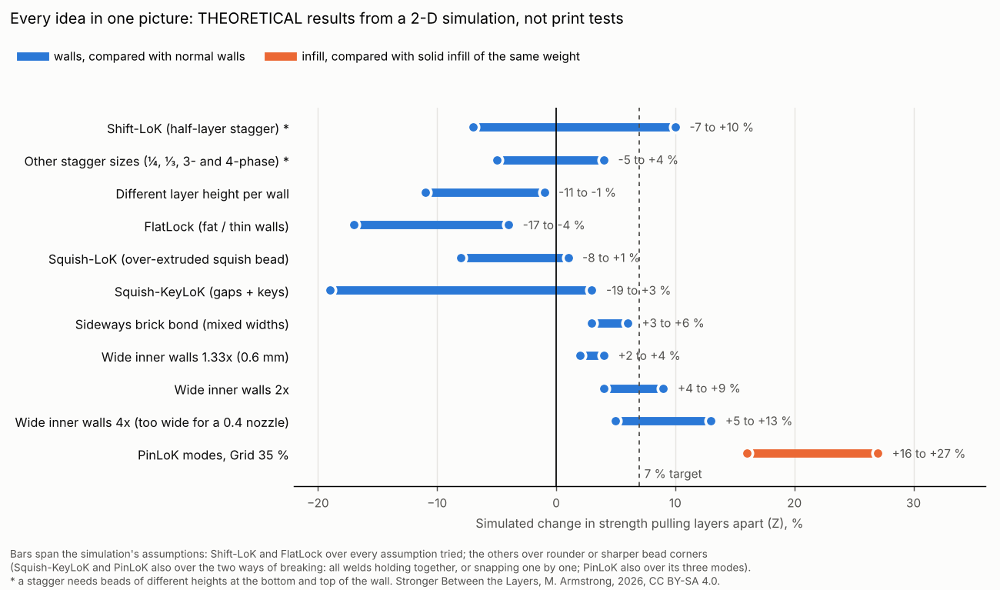
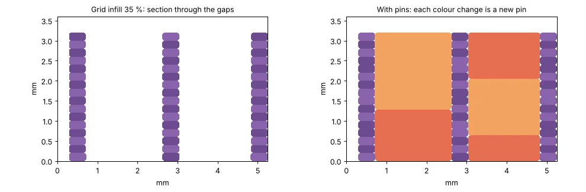

# A Bonding Experience

### The open-source new frontier of Z-delamination resistance

**A hobbyist's field guide to Z-strength in FDM printing without tripping over patents, and a defensive publication of PinLoK (pinned infill).**

By Matthew Armstrong ([The-Dorkknight](https://github.com/The-Dorkknight)), United Kingdom. First published 13 October 2026.

📄 **Read it:** [PAPER.md](PAPER.md) · [PDF](a-bonding-experience-v1.0.pdf) · [web page](https://the-dorkknight.github.io/a-bonding-experience/)

> **Every strength number for my own ideas here, including Shift-LoK, FlatLock and PinLoK, is theoretical:** it comes from a 2-D computer simulation with known blind spots (paper, section 3), not from printed and tested parts. They are not product claims and say nothing about anyone else's products or patents. Real-world numbers quoted from others are linked to their sources. **Not legal advice.**

## In one minute

Printed parts snap along their layers. The famous fix, staggering walls by half a layer ("brick layers"), is patented in the US. I went looking for every way to get stronger layers *without* beads of different heights, ran twelve ideas through a strength model, and wrote down what happened, failures included.

| Idea | Simulated result across the layers (theoretical) | Verdict |
|---|---|---|
| "Loopholes" (variable first layer, smaller or multi-phase staggers) | about the same as normal; still needs different bead heights | geometry doesn't care about wording |
| Different layer height per wall | −1 to −11 % | weaker |
| FlatLock (fat/thin walls) | −4 to −17 % | weaker |
| Squish-LoK (over-extruded squish bead) | −8 to +1 % | nothing to fill |
| Squish-KeyLoK (keyed gaps) | −19 to +3 % | keys snap off |
| **Wide inner walls** (about 1.5 × nozzle) | +2 to +9 % | **partial success, just a slicer setting** |
| **PinLoK pinned infill** | **+16 to +27 %** against solid infill of the same weight | **best result; costs print time** |

**PinLoK** builds on Oak Ridge National Laboratory's published Z-pinning. Every few layers the nozzle stops over half of the open gaps in Grid infill and pushes a blob of plastic down into each one; the other half get theirs next time, so the joints never line up. A **potato mode** keeps each push to about a second for stock printers like the Ender 3. A late discovery: pins that end half-way through a layer, not on a layer line, did far better in the simulation.

## Why it's published

- **To keep it free.** Once a method is published, nobody can validly patent it afterwards. Section 9 of the paper discloses PinLoK and its variations in buildable detail, and the methods are dedicated to the public.
- **To bring makers together.** Open notebooks let tinkerers build on each other's work instead of repeating it. Print the test plan, post your results as an issue or discussion, fork it, improve it: everyone who contributes gets credited in the next version (paper, section 11).
- **To save you the dead ends.** Most of the ideas here didn't work. Now you know without trying.
- **Selfishly:** more cool 3D-printing techniques come back from the community, and I am now 22.713333…% more employable. High-efficiency synergy.

## What's in here

| Folder | What |
|---|---|
| [`PAPER.md`](PAPER.md), the PDF, [`docs/`](docs/) | The paper as Markdown, PDF and a web page |
| [`figures/`](figures/) | Every figure |
| [`pinlok/`](pinlok/) | The PinLoK G-code post-processor (Python 3.8+, no dependencies): `python3 pinlok/engine.py file.gcode --mode potato` |
| [`tests/`](tests/) | Its tests: `python3 -m unittest discover -s tests` |
| [`model/`](model/) | The strength model and every result file (needs numpy, scipy, matplotlib) |
| [`PUBLISHING.md`](PUBLISHING.md) | How this was published, and what makes it count as published |

The full app (LoK Walls: FlatLock, PinLoK and a locked brick-layer pattern, with installers for Cura, PrusaSlicer and OrcaSlicer) is in a separate repository, to be published after ADDMAN, the brick-layer patent holder, has been asked. I haven't contacted them yet; I intend to.

## Research paper

**[A Bonding Experience: The Open-Source New Frontier of Z-Delamination Resistance (a hobbyist's field guide to Z-strength in FDM printing without tripping over patents, including a defensive publication of PinLoK, pinned infill)](PAPER.md)** (version 1.0, first published 13 October 2026) · [PDF](a-bonding-experience-v1.0.pdf)

>-

The paper's text and figures: [CC BY-SA 4.0](LICENSE.md)

**How to cite:** Armstrong, M. (2026). *A Bonding Experience: The Open-Source New Frontier of Z-Delamination Resistance (a hobbyist's field guide to Z-strength in FDM printing without tripping over patents, including a defensive publication of PinLoK, pinned infill).* Version 1.0, 13 October 2026. https://the-dorkknight.github.io/a-bonding-experience/

## Licence

- **Paper text and figures:** [CC BY-SA 4.0](LICENSE.md). Share and adapt freely; adaptations credit this and stay CC BY-SA.
- **Code:** [PolyForm Noncommercial 1.0.0](LICENSE-CODE.md).
- **The methods:** dedicated to the public. Use them.

## Cite

See [CITATION.cff](CITATION.cff) (GitHub shows a "Cite this repository" button). Once archived, the DOI goes here: *DOI to be added*.
