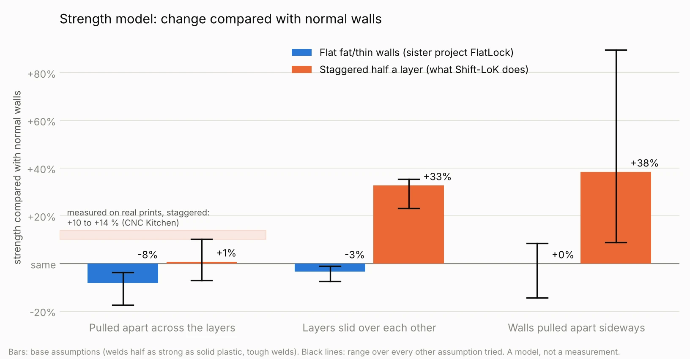

# Wall-pattern strength model

*Copied from the LoK Walls repository, where it lives in `tools/strength_sim`. Paths in the notes below refer to that layout; here every script and result file is in this folder and `results/`. See [PAPER.md](../PAPER.md) for what each run means.*

**This is a model, not a measurement.** Nothing here was printed or broken. It is a calculation that asks one narrow question: *given a set of stated assumptions, does a wall pattern force the wall to break along a longer or tougher surface than normal walls do?* Only a pull test on real prints can say how strong a part is.

The model was first built for the sister project FlatLock (flat fat/thin walls). Its result is the reason Shift-LoK exists: the staggered pattern Shift-LoK prints is the one that changed how the wall breaks. "Staggered" in the model means exactly what the Shift-LoK engine does: walls 1 and 3 half a layer higher, a first raised bead of 1.5 layers, a last bead of half a layer.

## Result in one paragraph

In a normal wall every layer ends at the same height, so the weak welds between layers line up in one flat plane and the wall parts along it. Raising every other inner wall by half a layer forces that weak surface to step up and down, and in the model the walls then resist sliding and sideways splitting much better. In a straight pull across the layers the model shows about the same strength as a normal wall (between 7 % weaker and 10 % stronger, depending on the assumptions), which is less than was measured on real prints. A flat fat/thin pattern, where every layer still ends at the same height, shows no gain at all.




## The numbers

Percent change against a normal wall in the same calculation. 5 walls, 0.45 mm line width, 0.2 mm layers unless stated. The first number is the base case; the range is over every other assumption that was tried.

| Load | Staggered half a layer (Shift-LoK) | Flat fat/thin, 25 % (FlatLock) |
|---|---|---|
| Pulled apart across the layers | **+1** (-7 to +10) | **-8** (-17 to -4) |
| Layers slid over each other | **+33** (+23 to +36) | **-3** (-7 to -1) |
| Walls pulled apart sideways | **+38** (+9 to +90) | **0** (-14 to +9) |

Other patterns, base case only:

| Pattern | Across the layers | Sliding | Sideways |
|---|---|---|---|
| Flat, 25 %, first inner wall at full strength | -13 | +7 | -2 |
| Flat, 40 %, first inner wall at full strength | -20 | +6 | 0 |
| Staggered, raised walls given 5 % more plastic | -10 | +27 | +52 |
| Staggered and fat/thin together | -9 | +19 | +20 |

So in this model adding fat/thin or extra plastic to a staggered wall does not help. The plain staggered wall is the best of the patterns tried, which is why Shift-LoK has no flow setting.

The full table is printed by `summarise.py` from [`results/results.jsonl`](results/results.jsonl) (102 calculations).

## How it compares with a real measurement

Two published tests of staggered walls were found to hold this model against.

- CNC Kitchen pulled brick-layer test parts apart (0.25 mm layers, 4 perimeters, no infill) and measured 14 % more force in PLA (944 N against 1072 N) and 10 % more in PETG. The break changed from a flat surface to a zig-zag. Earlier runs at 0.2 and 0.3 mm layers showed a slight increase that he called "probably not statistically significant".
- A conference paper from the University of Kragujevac (PLA tensile bars, five per set) reports in its abstract "improved performance in specimens printed using the brick-layer method, particularly when combined with increased flow rates" of +5 % and +10 %. The abstract gives no numbers.

The model gets the zig-zag break right. But its base case gives staggered walls only about +1 % in a straight pull, and reaches +10 % only when the seams between beads are assumed to fuse well. And it says extra flow makes a staggered wall worse, where the paper reports it helps. So the model is **more pessimistic than both real tests** for staggered walls. The likely reason is the first item in the list below. Neither test used G-code made by Shift-LoK.

## What the model assumes, and what it leaves out

1. **No squeezing pressure.** In a real print a bead that is pressed into a tight space bonds better to its neighbours. The model only knows shapes. A raised bead is laid into a slot between two walls that already stand, which is exactly where that would matter, and it is not in the model.
2. **A weld is weaker than solid plastic by one fixed factor** (half as strong in the base case; 0.35 and 0.7 also tried; side-to-side welds at 0.3 also tried). Real welds depend on temperature, speed, material and time.
3. **Voids come from one rule:** plastic cannot fill corners sharper than a set radius (22 % of the layer height in the base case; 10 % and 16 % also tried). Staggered walls are the most sensitive to this rule: with well-filled corners they gain 10 % across the layers, with poorly filled ones they lose a few percent.
4. **A flat slice.** It is a 2-D cross-section through a straight wall. No corners, curves, seams, infill, top and bottom skins or part shape.
5. **Perfect printing.** Every bead gets exactly its plastic at exactly its place. In the staggered wall about 1 % of the plastic found no room in the model (0.1 % for normal walls), which counts slightly against it.
6. **Static load only.** No fatigue, impact, creep or heat.
7. **Small sample.** 5 walls and 9 or 13 layers, one random seed for the limit calculations and three for the fracture ones.

## How it works

1. **Laying the beads** (`model.py`, `build`). Beads are put down one at a time on a 0.005 mm pixel grid, in printing order. Each has a fixed amount of plastic, is flattened on top by the nozzle and spreads sideways into the room that is left.
2. **Spring network** (`model.py`, `Lattice`). A triangular net of springs 0.015 mm long is laid over the picture. Springs inside one bead have full strength, springs crossing from one bead to another have weld strength, and there are none in voids.
3. **Two ways of loading it.**
   - *Tough limit* (`limit_load`): the largest load the net can carry when no spring may pull harder than its strength. This is solved exactly as a linear programme, and the solution also says where the net parts. Most numbers above are this.
   - *Fracture* (`pull`): the net is stretched, the most overloaded spring is removed (or softened in steps), and so on until it comes apart. "brittle" and "tough8" in the results are this.
4. **Three loads:** pulled apart across the layers, layers slid over each other, and walls pulled apart sideways.

## Running it

```
pip install numpy scipy matplotlib
python3 tools/strength_sim/run_all.py tools/strength_sim/results 2    # about an hour on two cores; skips what is already there
python3 tools/strength_sim/summarise.py tools/strength_sim/results chart.png
python3 tools/strength_sim/parting.py parting.png                     # a few minutes
```

The engine and the installer do not need any of this; they still use nothing but Python's standard library.

## Sources

- CNC Kitchen, brick layers pull test: https://cnckitchen.com/blog/brick-layers-make-3d-prints-stronger
- "An experimental study on layer adhesion in FDM 3D printing: comparing conventional and brick-layer deposition patterns" (abstract): https://doi.ub.kg.ac.rs/?p=98241

## explore.py (added 13 Oct 2026)

Runs alternative stagger patterns (quarter, third, three- and four-phase, different layer heights per wall) through the same model: `python3 explore.py results/explore.jsonl 2`. About 15 minutes on two cores. Results and discussion: RESEARCH.md section 10.

## squish.py and wide.py (added 13 Oct 2026)

`squish.py`: over-extruded "squish" beads laid last in a layer. `wide.py`: wide flat inner beads and a sideways brick bond. Same usage as explore.py. Discussion: RESEARCH.md section 11.

## keylok.py and brittle.py (added 13 Oct 2026)

`keylok.py`: Squish-KeyLoK (sideways gaps filled by a key from the bead above). `brittle.py`: one-by-one weld failure in Z, three seeds, for the KeyLoK and wide layouts. Discussion: RESEARCH.md section 12.

## sparse.py (added 13 Oct 2026)

Pinned Grid infill ("sparse squish", PinLoK): a vertical section through a row of grid cells, pins pushed into the open channels every N layers, A and B alternating, compared with plain and solid infill. Results in `results/sparse.jsonl` and `results/sparse2.jsonl`; discussion in RESEARCH.md section 16 and HOW_PINLOK_WORKS.md.

## PinLoK modes, one consistent run (added 13 Oct 2026)

`python3 sparse.py results/pinlok_modes.jsonl 2` runs every pinned-infill case in `sparse.py` (the tough limit in Z with seed 1, and the brittle pull in Z with seeds 1 to 3) and prints a summary against the solid case **in the same file**. All PinLoK figures in the paper and in RESEARCH.md section 16 come from this file. The earlier exploratory files `sparse.jsonl` and `sparse2.jsonl` mixed baselines from two runs and are kept only as a record; don't quote them.
